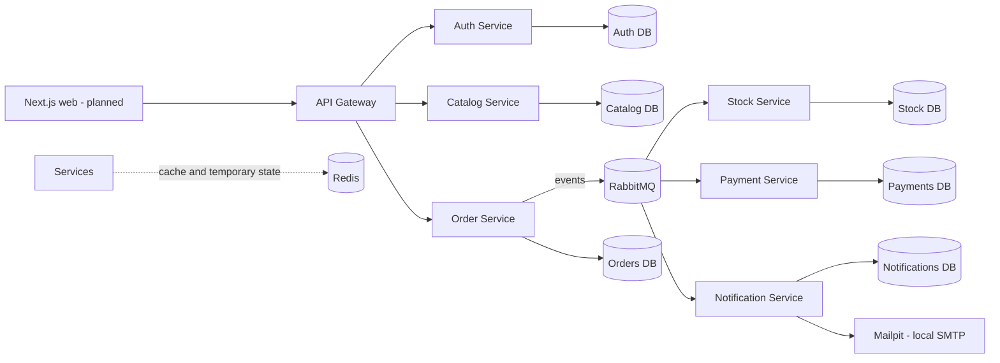

# Architecture

Pediritos is a pnpm workspace monorepo coordinated by Turborepo. Each application owns its domain and is intended to own its schema and migrations. Services communicate through versioned events on RabbitMQ; they must not read one another's database.

The development Compose file runs one PostgreSQL server with separate logical databases for each domain. Separate database servers can be used later without changing service ownership. Redis and RabbitMQ are shared infrastructure; they are not sources of truth for domain records.

The seven NestJS applications are still scaffolds. The API Gateway is the only one currently validating the shared environment schema. There is no Next.js app yet. `docker compose config` and container startup still need to be checked on a machine with Docker installed.

## Decisions

- Monetary values in shared contracts use integer minor units, such as centavos.
- Event envelopes carry a UUID, type, version, occurrence timestamp, correlation ID, and payload.
- Producers should persist event envelopes in their own transactional outbox in the same database transaction as domain changes. The shared package exposes an outbox relay contract; no service database adapter is wired yet.
- Consumers should use a durable `ProcessedEventStore`. The included in-memory store is for local/unit use only and is not crash-safe.
- The previous placeholder third-party telemetry SDK was removed because it required fake credentials and emitted worker failures. Structured logging is available; OpenTelemetry and Prometheus exporters remain future work.
